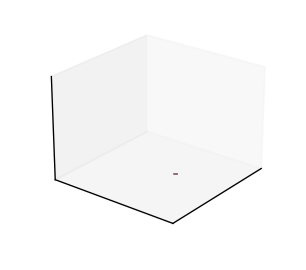
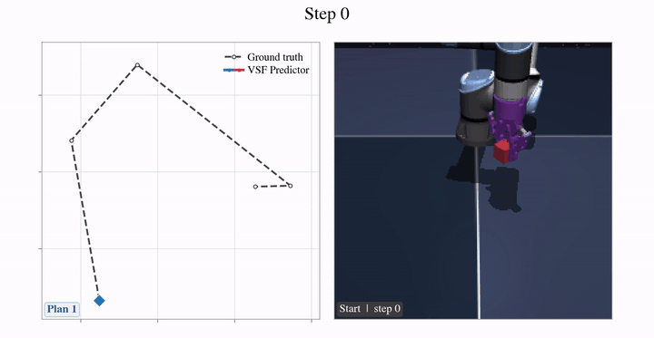

# Variational Streaming Flow

<p align="center">
  <a href="https://arxiv.org/abs/2610.00976">
    
  </a>
  <a href="https://github.com/hans66hsu/VSF-forecasting">
    
  </a>
  
</p>

Code for [**Variational Streaming Flow: Probabilistic Forecasting in Physical Time**](https://arxiv.org/abs/2610.00976). The repository supports dynamical-system forecasting and visual world models built on frozen LeWM representations.

## Abstract

Probabilistic forecasting is important for predicting complex dynamical systems because
intrinsic randomness and incomplete observations can cause the same observed state to evolve
into multiple plausible futures. While flow matching is a flexible approach for probabilistic
forecasting, it is computationally expensive. Streaming flow (SF) reformulates this approach
to model temporal evolution efficiently by learning a continuous velocity field directly in
physical time. However, SF learns a deterministic velocity field. Thus, it provides only a
single future trajectory for a given fixed initial state and observation history. To overcome
this limitation, we introduce Variational Streaming Flow (VSF). Our approach learns a
latent distribution that is conditioned on the dynamics of interest. In turn, this enables
probabilistic forecasting. Importantly, we retain the computational efficiency of SF by
generating in physical time. Across deterministic and stochastic dynamical systems, VSF
demonstrates superior predictive accuracy and distributional fidelity. We demonstrate the
advantage for both long-horizon rollouts exceeding 1,000 steps, and settings with bifurcating
dynamics. Moreover, VSF can be integrated into existing Joint-Embedding Predictive
Architecture (JEPA)-based world models as a plug-and-play predictor to improve temporal
dynamics and goal-directed success rate in navigation, motion planning, and manipulation.

<table>
  <tbody><tr>
    <th>Probabilistic forecasting<br><sub>Stochastic Rössler forecasting</sub></th>
    <th>World Model Predictor<br><sub>LeWM Cube planning</sub></th>
  </tr>
  <tr>
    <td align="center">
      
    </td>
    <td align="center">
      
    </td>
  </tr>
</tbody></table>

## Installation

Clone the repository and create the provided Conda environment:

```bash
git clone https://github.com/hans66hsu/VSF-forecasting.git
cd VSF-forecasting
conda env create -f env.yml
conda activate vsf
```

To update an existing environment:

```bash
conda env update -f env.yml --prune
conda activate vsf
```

## Dataset

The default dataset root is `data/`. It can be changed with the Hydra override `data_dir=/path/to/data`.

### Dynamical systems

The dynamical-system datasets do not need to be downloaded. If a configured `.npz` file is missing, the first training run simulates it and stores it in `data/`.

Alternatively, one can generate the trajectory and its preview plots from the repository root. For example, to visualize the `double-pendulum` trajectory run:

```python
python src/datasets/double_pendulum/data.py --config-path configs/dataset/double-pendulum.yaml
```
To run the stochastic Rössler, run:

```python
python src/datasets/rossler/data.py --config-path configs/dataset/rossler.yaml
```
To run the fully observed, deterministic version, replace `-configs/dataset/rossler.yaml` with `configs/dataset/rossler-deter.yaml`. The command saves the dataset `.npz` file under `data/` and its preview plots under `outputs/<dataset>/`.

### World model

The world-model datasets must be downloaded from [LeWM](https://github.com/lucas-maes/le-wm/tree/main). Unzip the download data with `tar --zstd -xvf archive.tar.zst` and place the `.h5` files under `data/`:

```text
data/
├── cube_single_expert.h5
├── cube_single_expert_image_embeddings.pt       # generated automatically
└── ...
```

Only the `.h5` files must be placed manually. Image embedding caches are generated beside each dataset on the first training run and reused later.

## LeWM checkpoints

Every world-model task requires its official pretrained [LeWM checkpoint](https://github.com/lucas-maes/le-wm/tree/main). Copy the matching `config.json` and `weights.pt` files into `model/<dataset>/`:

```text
model/
├── cube/
│   ├── config.json                              # required LeWM file
│   └── weights.pt                               # required LeWM file
├── pusht/
├── reacher/
├── tworoom/
└── ...
```

The `pusht/`, `reacher/`, and `tworoom/` folders follow the same structure as `cube/`.

## Forecasting

 `variational_streaming_flow.py` contains the implementation of VSF. Run Variational Streaming Flow on the double-pendulum dataset:

```python
python main.py --config-name=forecast dataset=double-pendulum models='[variational_streaming_flow]' dataset.rollout_horizon=19
```

Run Variational Streaming Flow on stochastic Rössler:

```python
python main.py --config-name=forecast dataset=rossler models='[variational_streaming_flow]' train.num_epochs=18 dataset.rollout_horizon=19
```

Replace `double-pendulum-broad` with `lorenz`, `lorenz-deter`, `rossler`, or `rossler-deter` to evaluate on another dynamical system. The command loads its matching checkpoint from `model/<dataset>/`, trains it if missing, evaluates it, and writes results under `outputs/<dataset>/<timestamp>/`.

We include VSF configs for the forecasting tasks in [`reproduce_forecast.txt`](reproduce_forecast.txt).

### Weights & Biases

One can use Weights & Biases to visualize generated trajectories and monitor training progress. Logging is disabled by default. Log in once, then enable online logging with Hydra overrides:

```python
wandb login
python main.py --config-name=forecast dataset=double-pendulum models='[variational_streaming_flow]' dataset.rollout_horizon=19 wandb.mode=online wandb.project=VSF
```

Add `wandb.entity=YOUR_ENTITY` when the run should belong to a specific user or team. The remaining logging options are under `wandb` in [`configs/forecast.yaml`](configs/forecast.yaml).

## World Model

`vsf_predictor.py` contains the implementation of VSF as a world model predictor. Run VSF as a LeWM predictor on PushT tasks:
```python
python main.py --config-name=world_model dataset=pusht predictor.models='[VSFPredictor]'
```

You can choose `cube`, `pusht`, `reacher`, and `tworoom` for `dataset`. The command trains VSF and evaluates it with CEM planning. Results are saved under `outputs/<dataset>/<timestamp>/`.

We include VSFPredictor configs for the world model planning in [`reproduce_wm.txt`](reproduce_wm.txt).
